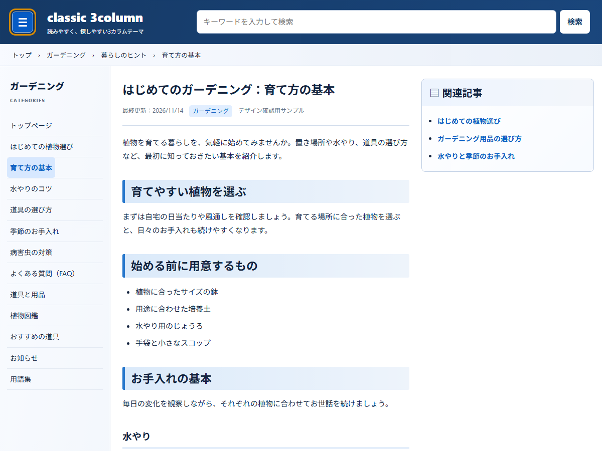

# classic 3column

読みやすさを重視した、汎用3カラムのWordPressテーマです。現在の配布版は **1.0.10** です。

## 特徴

- PCでは左ナビ・本文・右サイドバーの3カラム。
- 左ナビの開閉状態をブラウザーに保存。
- 幅900px以下ではスライドメニューを使用し、右サイドバーは本文下に表示。
- 左右のウィジェット、カスタムメニュー、ロゴ、アイキャッチ画像に対応。
- 本文カラムは左右の余白を含めて最大680px。

## インストール

1. [リリース](https://github.com/kwdig/classic-3column/releases/latest)から `classic-3column-1.0.10.zip` をダウンロードします。
2. WordPressの「外観 → テーマ → 新規追加 → テーマのアップロード」でZIPを選択します。
3. インストールして有効化し、メニュー・ロゴ・左右のウィジェットを設定します。

WordPress 6.4以上、PHP 7.4以上が必要です。詳細は [README-ja.txt](README-ja.txt) を参照してください。

## GitHub配布ZIPのインストール検証

2026年11月26日、GitHubリリースからダウンロードした `classic-3column-1.0.10.zip` を、新規のWordPress Playground検証環境（WordPress 7.1.5／PHP 8.3.36／SQLite）にインストールして確認しました。

- ZIPからのインストールとテーマ1.0.10の有効化に成功。
- WordPressのテーマ検証エラーなし。
- 作成した記事ページとテーマCSSがHTTP 200で読み込み成功。
- 確認した処理で、テーマに関するPHPエラーなし。

この検証は上記環境でのインストール・有効化と基本的な読み込みを対象としています。

## 紹介・デモ

- [テーマ紹介](https://kwdig.com/classic-3colum)
- [デモ](https://kwdig.com/classic-3colum/demo/)

## ライセンス

GNU GPL v2以降。全文は [COPYING](COPYING)、補足は [LICENSE.txt](LICENSE.txt) を参照してください。
